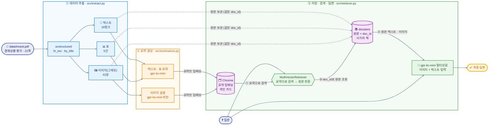
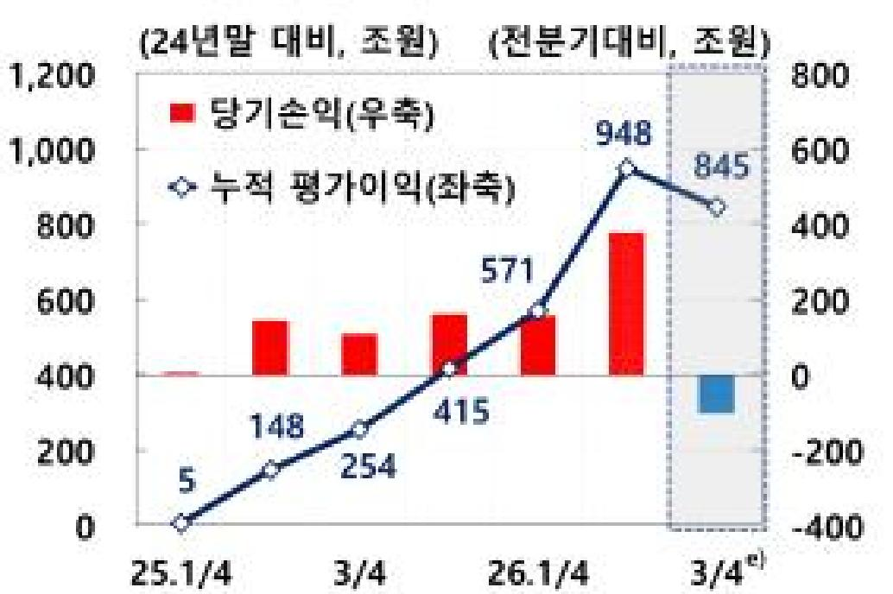

# Multimodal RAG

> PDF 속 **텍스트 · 표 · 이미지(그래프)** 를 함께 검색해 답하는 멀티모달 RAG 프로젝트
> 자료: 「경제상황 평가(2026.10월)」 보도자료 (PDF, 21쪽) — 핵심 수치가 **그래프 이미지 안에만** 있는 자료


## 목차

| # | 항목 | 핵심 내용 |
| --- | --- | --- |
| 1 | [데이터 추출](#1-데이터-추출) | 텍스트 18청크 · 표 5건 · 이미지 41장, `data/figures/` 생성 |
| 2 | [요약 생성](#2-요약-생성) | 텍스트 · 표 · 이미지 요약 64건 |
| 3 | [검색과 체인](#3-검색과-체인--질의응답-5건) | 다중 벡터 검색기 + 멀티모달 체인, 질의응답 5건 |
| 4 | [구조 이해](#4-구조-이해--요약으로-검색-원본으로-생성) | 요약으로 검색하고 원본으로 생성하는 이유 |
| 5 | [기술 선택 근거](#5-기술-선택-근거) | 모델 · 청크 · 프롬프트 언어 |
| 6 | [문제 정의](#6-문제-정의) | 그래프 속 수치를 텍스트 RAG가 못 찾는 문제 |
| 7 | [아키텍처 다이어그램](#7-아키텍처-다이어그램) | 추출 → 요약 → 검색·답변 3단계 |
| 8 | [Before / After](#8-before--after--일반-rag-vs-멀티모달-rag) | 답변 불가 → 571조 원 |
| 9 | [보안 처리](#9-보안-처리) | `.env` 제외, 키 노출 없음 |
| - | [한계점](#한계점) · [실행 방법](#️-실행-방법) · [폴더 구조](#-폴더-구조) | |

> 모든 실행 결과는 [`notebooks/Multi_modal_RAG.ipynb`](notebooks/Multi_modal_RAG.ipynb) 출력 셀에서 확인할 수 있다.

---

## 1. 데이터 추출

`unstructured` 의 `partition_pdf(strategy="hi_res")` 로 PDF의 레이아웃을 분석해 **텍스트 · 표 · 이미지를 모두 분리**했다.

| 종류 | 추출 결과 | 저장 위치 |
| --- | --- | --- |
| 텍스트 | 12블록 → 토큰 기준 분할 후 **18청크** | `data/processed/extracted.pkl` |
| 표 | **5건** (`infer_table_structure=True`) | `data/processed/extracted.pkl` |
| 이미지 | 그래프 · 도표 **41장** (`.jpg`) | **`data/figures/`** (Git 제외) |

- 코드: [`src/extract.py`](src/extract.py) · 노트북 `1-1 ~ 1-4` 셀
- `data/figures/` 는 실행 시 자동 생성되며, 용량 문제로 Git에는 올리지 않는다. 대표 그래프는 [`docs/images/`](docs/images/) 에 따로 넣었다.

---

## 2. 요약 생성

검색에 쓸 요약문을 **텍스트 · 표 · 이미지 모두** 만들었다 (총 64건).

| 종류 | 개수 | 프롬프트 | 결과 |
| --- | --- | --- | --- |
| 텍스트 요약 | 18건 | 한국어 | 원문 22,738자 → 요약 8,144자 (약 36%) |
| 표 요약 | 5건 | 한국어 | 표의 지표와 수치를 항목별로 정리 |
| 이미지 요약 | 41건 | 영어 지시 + 한국어 출력 | 그래프 1장당 평균 약 97자 설명 |

**요약 예시 (이미지)** — Before/After 근거 그래프 `figure-16-39.jpg` 의 요약문

> 2024년 말 대비 조원 단위의 당기손익과 누적 평균이익을 나타내는 그래프. 빨간색 바는 당기손익을, 파란색 점선은 누적 평균이익을 표시하며, 주요 수치는 25.1/4, 26.1/4에 대한 변화를 보여줌.

- 요약은 **"무슨 그래프인지"** (단위, 시점, 지표)를 담아 검색에 걸리게 하는 역할이다. 실제로 이 요약으로 질문 1번의 근거 그래프가 1순위로 검색됐다.
- 반면 요약에는 **571 같은 구체 수치가 없고**, "평가이익"을 "평균이익"으로 잘못 적었다. 그래서 답변은 요약이 아니라 **원본 이미지**로 만든다 (→ [4. 구조 이해](#4-구조-이해--요약으로-검색-원본으로-생성)).
- 코드: [`src/summarize.py`](src/summarize.py) · 노트북 `2-1 ~ 2-5` 셀

---

## 3. 검색과 체인 · 질의응답 5건

- **검색기**: `MultiVectorRetriever` — 요약은 Chroma, 원본은 docstore에 같은 `doc_id` 로 저장하고, 질문과 가까운 요약 4건(k=4)의 **원본**을 돌려준다.
- **체인**: 검색된 원본을 이미지 / 텍스트로 나눠 **이미지 먼저 + 텍스트 + 질문** 순서로 `gpt-4o-mini` 에 전달한다.
- 코드: [`src/retriever.py`](src/retriever.py) · 노트북 `3-1 ~ 4-2`, `6-1 ~ 6-2` 셀

| 질문 | 근거가 된 원본 (텍스트에는 표 포함) | 답변 |
| --- | --- | --- |
| 24년말 대비 26년 1분기의 누적 평가이익을 알려줘 | 이미지 3건 / 텍스트 1건 | 26년 1분기의 누적 평가이익은 571조 원입니다.... |
| 이 문서의 핵심 주제를 한 문장으로 요약해줘 | 이미지 0건 / 텍스트 4건 | 이 문서의 핵심 주제는 "최근 한국 경제의 민간소비 회복세가 반도체 경기 호조에도 불구하고 상대적으로 완만하며, 소비 증가 품목의 비중이 제한적이라는 점"입니다.... |
| 문서에 나온 표의 내용을 설명해줘 | 이미지 4건 / 텍스트 0건 | 자료에 나온 표의 내용을 설명하겠습니다.  첫 번째 표는 특정 기간 동안의 수치를 나타내는 막대 그래프입니다. x축은 날짜를 나타내며, y축은 수치를 나타냅니다. 그래프에서 가장 높은 수치는 43으로 보이며, 이는 ... |
| 가장 중요한 수치 3가지를 알려줘 | 이미지 4건 / 텍스트 0건 | 1. 첫 번째 그래프에서 25일의 수치는 약 60입니다. 2. 두 번째 그래프에서 1분위의 비율은 50%입니다. 3. 세 번째 그래프에서 26.2/4분기의 제조업 기대비는 -10입니다.... |
| 이 문서가 다루지 않는 내용은 무엇인지 알려줘 | 이미지 2건 / 텍스트 2건 | 이 문서가 다루지 않는 내용은 "배당소득이 없는 가구의 소비지출 변화"입니다. 문서에서는 배당소득이 있는 가구에 대한 소비지출 변화만을 다루고 있습니다.... |

> 위 결과는 `notebooks/Multi_modal_RAG.ipynb` `6-1` 셀의 실행 출력이다. 요약·검색 결과는 실행마다 문구가 조금씩 달라질 수 있다.

> 💡 **관찰**: 수치·그래프를 묻는 질문은 이미지 원본이, 주제 요약 질문은 텍스트 원본이 주로 검색되는 걸 확인할 수 있다. 다만 3·4번처럼 질문이 막연하면 어느 그래프를 근거로 삼았는지 불분명한 답이 나온다 (→ [한계점](#한계점)).

---

## 4. 구조 이해 : 요약으로 검색, 원본으로 생성

**"요약"은 어떻게 사용하는가**
- **텍스트 임베딩만으로는 이미지를 질문과 직접 비교하기 어렵다.** 질문은 글자이고 그래프나 이미지 형식 표는 그림이라, 바로 유사도를 계산할 수 없다. 그래서 이미지를 먼저 **텍스트로 요약**하고, 그 요약을 임베딩해서 **검색 인덱스로 활용**한다.

**"원본"은 어떻게 사용하는가**
- **요약만 LLM에 전달해주면 원본 정보가 손실된다.** 요약에는 정확한 수치 등 디테일이 누락될 수 있다. 그래서 검색된 요약의 `doc_id`(uuid)로 **원본(표, 이미지)** 을 꺼내 LLM에 넘긴다.
- 실제 사례: `figure-16-39.jpg` 의 요약에는 571이라는 값이 없지만, 원본 그래프를 받은 LLM은 26.1/4 지점의 라벨을 읽어 **571조 원**이라고 정확히 답했다.

**정리**
- **요약은 "색인 카드", 원본은 "서가의 책"** 으로 비유할 수 있다. 카드로 책을 찾고, 답은 책을 직접 펴서 읽고 쓴다.
- 이 역할 분담을 하는 것이 `MultiVectorRetriever` (요약 → Chroma, 원본 → docstore, 둘을 같은 `doc_id`(uuid)로 연결)

---

## 5. 기술 선택 근거

| 항목 | 선택 | 이유 |
| --- | --- | --- |
| PDF 파싱 | `unstructured` (`strategy="hi_res"`) | 표 구조(`infer_table_structure`)와 그래프 이미지를 따로 뽑으려면 레이아웃 분석이 필요해 `fast`가 아닌 `hi_res`를 사용 |
| 1차 청크 | `by_title`, 최대 4000자 | 문서의 제목 단위로 끊어 문맥이 중간에서 잘리지 않게 함 |
| 2차 청크 | 토큰 기준 2000 / overlap 200 | 요약 입력 길이를 일정하게 맞추고, 경계에서 문장이 끊겨도 내용이 이어지도록 overlap 값을 설정 |
| 요약·답변 모델 | `gpt-4o-mini` (`temperature=0`) | 텍스트와 이미지를 모두 처리하는 멀티모달 모델 중 비용이 낮아, 이미지 41장을 요약하는 반복 실행에 적합함. 답변이 일관되도록 temperature=0 설정 |
| 임베딩 | `text-embedding-3-small` | 한국어 요약문 검색에 충분하고 비용이 낮음 |
| 벡터 DB / 원본 저장 | Chroma / `InMemoryStore` | 메모리에 저장하여 실행 시에만 유지되는 가벼운 InMemoryStore를 사용함 |
| 답변 프롬프트 | 한국어로 답하기 + 수치는 값과 단위까지 + 자료에 없으면 모른다고 답하기 | 근거 없는 추측(환각)을 막고, 수치 질문에서 단위가 빠져 의미가 사라지는 것을 방지 |
| 요약 저장 | `data/processed/summaries.pkl` | 요약은 실행할 때마다 문장이 조금씩 달라질 수 있고 API 비용도 들기 때문에, 한 번 만든 요약을 저장해 재사용 |
| 프롬프트 언어 | 텍스트·표 요약: 한국어 / 이미지 요약: **영어 지시 + 한국어 출력** / 최종 답변: 한국어 | 이미지 요약은 영어 지시가 품질이 안정적이고 토큰최적화에 유리하여 영어로 지시하되, 질문이 한국어이므로 요약문은 **한국어로 출력**하게 해 질문과 같은 언어로 맞춤 |

---

## 6. 문제 정의

사용한 자료는 「경제상황 평가(2026.10월)」 보도자료(PDF, 21쪽)이다. 이 자료는 핵심 수치가 **본문 문장이 아니라 그래프 이미지 안에** 들어 있다.
(예시: "24년말 대비 26년 1분기 누적 평가이익"과 같은 수치는, 그래프 이미지에서 읽어내야 한다.)

일반 RAG는 텍스트만 임베딩하므로 이런 질문에 **"자료에 없습니다"** 라고 답하거나 틀린 답을 한다.
멀티모달 RAG는 **그래프와 표까지 검색 대상에 넣어**, 그래프나 표에 근거가 있는 질문에 LLM이 답을 할 수 있게 한다.

| 항목 | 내용 |
| --- | --- |
| 자료 | `data/invest.pdf` (경제상황 평가 보도자료, 21쪽, 공개 자료) — 저장소에 포함 |
| 추출 결과 | 텍스트 18청크 · 표 5건 · 이미지 41장 (총 64건 색인) |
| 선정 이유 | 본문 텍스트와 함께 표 5건·그래프 등 이미지가 풍부하고, 10~30쪽 분량(21쪽)의 공개 자료여서 요약 비용도 감당할 수 있음 |
| 해결할 문제 | 그래프·표 속 수치를 묻는 질문에 텍스트 전용 RAG가 답하지 못함 |

---

## 7. 아키텍처 다이어그램



> 🔵 ① 추출 → 🟠 ② 요약 → 🟢 ③ 검색·답변 순서이며, 🟣 보라색 저장소 두 개를 같은 `doc_id`로 연결하는 것이 핵심이다.

| 단계 | 모듈 | 실습 노트북 | 내용 |
| --- | --- | --- | --- |
| ① | `src/extract.py` | `practice/01_데이터추출__연습본.ipynb` | PDF에서 텍스트·표·이미지 분리 |
| ② | `src/summarize.py` | `practice/02_요약생성_학습_(주석만).ipynb` | 텍스트·표 요약 / 이미지 설명 생성 |
| ③ | `src/retriever.py` | `practice/03_임베딩_최종체인_연습.ipynb` | 임베딩, 다중 벡터 검색기, 멀티모달 최종 체인 |

---

## 8. Before / After : 일반 RAG vs 멀티모달 RAG


같은 질문 **"24년말 대비 26년 1분기의 누적 평가이익을 알려줘"** 에 대한 두 RAG(일반RAG vs 멀티모달RAG)의 답변이다. 같은 모델("gpt-4o-mini")과 같은 검색 개수(k=4)를 사용하지만, **핵심 차이는 검색 대상과 답변 생성 시 LLM 입력에 이미지와 표를 넣었는지 여부이다.** (프롬프트 지시문은 문구가 약간 다르다.)

| | Before (텍스트 전용 RAG) | After (멀티모달 RAG) |
| --- | --- | --- |
| 검색 대상 | 텍스트 원문 청크만 | 텍스트 + 표 + 이미지의 요약 |
| LLM 입력 | 텍스트만 | 텍스트 + 표 + 이미지 원본 |
| 답변 | "구체적인 수치나 정보가 포함되어 있지 않습니다" | "**571조 원**" |
| 결과 | 답변 불가 | 근거 있는 수치 답변 |

**답변의 근거 이미지** (`data/figures/figure-16-39.jpg`, 멀티모달 RAG가 검색해 LLM에 전달한 원본 그래프 중 하나)



- 파란 선이 "누적 평가이익(좌축, 24년말 대비, 조원)"이며, 26.1/4 지점의 데이터 라벨이 **571**이다. 멀티모달 RAG의 답("571조 원")이 이 라벨에서 나왔다.
- 같은 그래프에는 948(26.2/4 추정), 845 등 다른 시점의 값도 있어서, 질문의 시점(26년 1분기)과 맞는 점을 골라 읽는 것이 핵심이다.

**차이가 생긴 이유**: 해당 수치는 본문 문장에 없고 그래프 이미지 안에만 존재한다. Before는 이미지를 색인하지 않아 근거를 찾지 못했고, After는 이미지 설명이 검색에 걸린 뒤 **원본 이미지를 멀티모달 LLM이 직접 읽어** 값을 답했다.

---

## 9. 보안 처리

- `.env`(API 키)는 `.gitignore`로 제외하고, 필요한 환경변수는 `.env.example`에 더미 값으로만 안내한다.
- 과제 자료(`data/invest.pdf`) 외의 PDF, 추출 이미지(`data/figures/`), 중간 결과(`*.pkl`, `processed/`), 벡터 DB(`chroma_db/`), 가상환경(`.venv/`), 에디터 설정(`.vscode/`)도 제외한다.
- 코드는 키를 하드코딩하지 않고 `load_dotenv`로 `.env`에서 읽으며, 키가 없으면 `ValueError`를 발생시킨다. 제출 노트북(`notebooks/Multi_modal_RAG.ipynb`)은 키 값을 출력하지 않아, 출력 셀에도 키 문자열이 남지 않는다.
- 저장소 전체와 커밋 이력에서 `sk-` 형태의 키 문자열이 없는 것을 확인했다.

---

## 한계점

- **그래프 수치는 해상도나 모델 성능에 따라 오차가 있을 수 있다:** 이미지에서 값을 읽는 방식이라 오차가 있을 수 있고, 질의 4번처럼 어느 그래프의 어떤 지표인지 모호한 답이 나올 수도 있다.
- **표와 그래프를 혼동할 수 있다:** 질의 3번에서 "표"를 물었는데 검색된 원본이 모두 이미지(4건)였고, 막대 그래프를 "표"라고 설명했다. 추출된 이미지 41장에는 로고·장식 이미지도 섞여 있어, 검색 품질을 떨어뜨리는 노이즈가 된다.
- **요약 자체의 오류:** 이미지 요약이 "누적 평가이익"을 "누적 평균이익"으로 적는 등, 요약 단계에서 용어나 수치가 틀릴 수 있다. 여러 줄 머리글이 있는 표는 텍스트로 펼쳐지면서 연도·분기 구분이 흐려져, 표 요약이 시점을 잘못 대응시키기도 한다.
- **LLM 호출 비용 문제:** 요약 단계는 OpenAI API를 호출해 실행마다 비용이 들고, 검색기는 메모리 기반이라 프로세스를 종료하면 색인이 사라진다. 다만 요약 결과는 `data/processed/*.pkl` pickle 파일로 저장해 재사용한다. 비용을 절감하기 위해서, 메모리 대신 디스크 저장 방식을 택하여 색인을 반영구 저장하는 걸 고려할 수 있다.
- **실행할 때마다 결과가 달라질 수 있다:** 요약문이 매번 조금씩 달라지면 검색 순위가 바뀌고, 같은 질문에도 답이 달라진다. 실제로 요약을 다시 만든 뒤 실행한 `practice/03_임베딩_최종체인_연습.ipynb` 에서는 질문 1번에 **948조 원**(같은 그래프의 26.2/4 시점 값)으로 답했다. 질문의 시점(26년 1분기)과 다른 점의 값을 읽은 것이다. 그래서 요약을 pkl로 저장해 재현성을 확보했지만, 검색이 요약 문장에 민감하다는 근본 문제는 남아 있다.
- **개선 방향:** (1) 일정 크기 이하의 로고·장식 이미지를 요약 전에 걸러낸다. (2) 표·이미지 요약 프롬프트에 문서 제목과 단위를 함께 넘긴다. (3) 질의는 시점·지표를 구체적으로 지정한다.
- **단일 문서·한 가지 PDF 구조에 맞춘 비유연성 문제:** 청크 크기와 프롬프트는 이 과제에서 사용한 `data/invest.pdf`(원본 파일명: "[보도자료] 경제상황 평가(2026.10월)_FFF.pdf") 기준으로 정했으며, 다른 문서를 파싱할 경우 해당 문서 형식에 맞춰야 한다.
- 실제 프로젝트를 수행한다면 정답률 통계, A/B 테스트를 통한 답변 품질 개선 등을 정량적으로 비교하여야 한다.

---

## ⚙️ 실행 방법

### 1. 환경 설정

```bash
git clone https://github.com/8113jsl-ui/Multimodal_RAG.git
cd Multimodal_RAG

# 가상환경 생성 및 활성화
python -m venv .venv
source .venv/bin/activate          # 윈도우: .venv\Scripts\activate

# 의존성 설치
pip install --upgrade pip
pip install -r requirements.txt     # 또는 requirements.lock.txt

# 커널 등록
python -m ipykernel install --user --name multimodal-rag

# .env 작성
cp .env.example .env                # 윈도우: copy .env.example .env
# .env 파일을 열어 실제 API 키를 입력
```

VS Code에서는 Python 인터프리터와 노트북 커널을 `.venv\Scripts\python.exe`로 선택한다.

PDF 표·이미지 추출(`hi_res`)에는 **Poppler**와 **Tesseract** 설치가 필요하다. 설치 후 터미널에서 `pdftoppm -h`, `tesseract --version` 이 출력되면 정상이다.

### 2. PDF 확인

원본 PDF는 저장소의 `data/invest.pdf` 에 포함되어 있어, clone 후 바로 실행할 수 있다.

### 3. 실행

**방법 A — 전체 노트북 (권장)** : `notebooks/Multi_modal_RAG.ipynb` 를 위에서부터 실행한다. ① 추출 → ② 요약 → ③ 검색기 → ④ 최종 체인 → ⑤ Before/After → ⑥ 질의응답 5건이 한 번에 실행된다. `data/processed/*.pkl` 이 있으면 추출·요약은 저장본을 불러와 시간과 비용을 아낀다.

**방법 B — 단계별 노트북** : 아키텍처 표의 `practice/` 노트북을 `01 → 02 → 03` 순서로 실행한다.

**방법 C — 스크립트** : 프로젝트 루트에서 순서대로 실행한다.

```bash
python src/extract.py      # ① 추출  → data/figures/, data/processed/extracted.pkl
python src/summarize.py    # ② 요약  → data/processed/summaries.pkl  (API 비용 발생)
python src/retriever.py    # ③ 검색·답변, Before/After, 질의 5건  (API 비용 발생)
```

> ⚠️ `.env`에는 실제 API 키가 들어가므로 **절대 커밋하지 않는다** (`.gitignore`에 등록됨).

---

## 📁 폴더 구조

```
Multimodal_RAG/                     # GitHub 저장소 기준
├── .env.example                    # 키 없는 환경변수 템플릿
├── .gitignore
├── README.md                       # 프로젝트 개요
├── requirements.txt                # 필수 패키지
├── requirements.lock.txt           # 버전 고정 목록
├── data/
│   └── invest.pdf                  # 원본 PDF (경제상황 평가 보도자료)
├── docs/
│   └── images/
│       └── evidence_cumulative_gain.jpg   # Before/After 근거 그래프
├── notebooks/
│   └── Multi_modal_RAG.ipynb       # 전체 파이프라인 실행 노트북 (출력 포함)
├── practice/                       # 수업 단계별 실습 노트북
│   ├── 01_데이터추출__연습본.ipynb
│   ├── 02_요약생성_학습_(주석만).ipynb
│   └── 03_임베딩_최종체인_연습.ipynb
└── src/
    ├── extract.py                  # ① PDF 파싱 · 분류
    ├── summarize.py                # ② 텍스트·표·이미지 요약
    └── retriever.py                # ③ 다중 벡터 검색기 · 최종 체인 · Before/After
```

로컬에서 실행하면 아래 파일·폴더가 추가로 생기며, 모두 `.gitignore`로 제외된다.

| 경로 | 내용 |
| --- | --- |
| `.env` | 실제 API 키 |
| `.venv/` | 가상환경 |
| `data/figures/` | 추출된 이미지 |
| `data/processed/*.pkl` | 추출·요약 중간 결과 |
